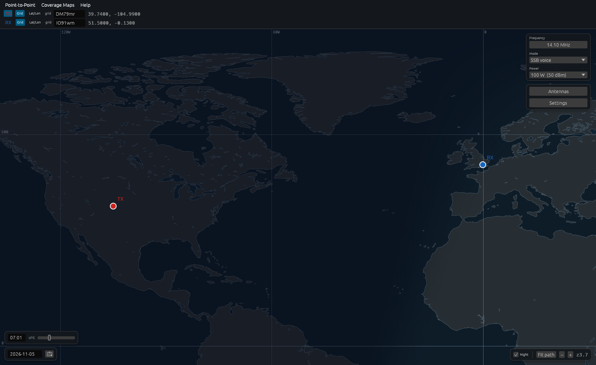

<a name="top"></a>

[](https://github.com/GabrielVicini/Skipzone)

# Skipzone

**3D ionospheric HF ray tracing** with Haselgrove equations and full Appleton-Hartree magnetoionic theory.

[](https://www.rust-lang.org)
[](crates/skipzone/Cargo.toml)
[](LICENSE)
[](crates/skipzone/Cargo.toml)
[](https://github.com/GabrielVicini/Skipzone/actions/workflows/ci.yml)
[](docs/README.md)

<!-- OWNER: write this yourself. One line on the project's status (for example pre-alpha) and what you want from people trying it. -->

Skipzone predicts HF radio paths by tracing rays through a 3D model of the
ionosphere, using the IGRF geomagnetic field and the full complex
Appleton-Hartree refractive index for both O and X modes. It ships as a desktop
map application for point-to-point and coverage predictions, built on an engine
crate that can be embedded on its own.



## Running it

```bash
cargo run --release
```

This builds and launches the desktop app. Building the app needs Rust 1.92+
(the engine alone builds on 1.85). On Linux the app also needs the X11 or
Wayland development headers that `eframe` uses.

Everything else (using the app, reading a prediction, how it works, accuracy,
the command-line tools, contributing) is in the
[wiki](https://github.com/GabrielVicini/Skipzone/wiki). The derivations and
reports are indexed in [docs/](docs/README.md).

## Crates

| Crate | What it is |
|---|---|
| [`crates/skipzone`](crates/skipzone) | The engine: ray tracer, Appleton-Hartree, IGRF field, integrator and homing. No system libraries, `unsafe` forbidden. |
| [`crates/skipzone-iono`](crates/skipzone-iono) | The ionosphere: Chapman layers, CCIR foF2 maps, sporadic E and solar geometry. |
| [`crates/skipzone-predict`](crates/skipzone-predict) | Headless link prediction: scenarios, the solve, antennas, noise, sweeps and coverage, plus the `hfpredict` CLI. |
| [`crates/skipzone-lab`](crates/skipzone-lab) | Validation and calibration against WSPR and ionosonde measurements, and every harness binary. The only crate with network access. |
| [`app`](app) | The `egui` desktop front end. |

Dependencies point one way: engine ← iono ← predict ← {lab, app}, and
`scripts/check-boundaries.py` enforces it in CI.

## License

MIT, except `crates/skipzone-iono/data/nequick/` (EUPL-1.2). See [LICENSE](LICENSE).

The bundled NeQuick reference data under `crates/skipzone-iono/data/nequick/` is EUPL v1.2 and
carries its own notice; see [crates/skipzone-iono/data/nequick/README.md](crates/skipzone-iono/data/nequick/README.md).
The other bundled data keeps its upstream terms: the IGRF-14 coefficients in
`crates/skipzone/data/igrf14coeffs.txt` are published by IAGA and freely available, and the Natural
Earth shapefiles in `crates/skipzone-predict/src/assets/` are public domain.

For any licensing concerns or questions, email `hello@vicini.io`.
