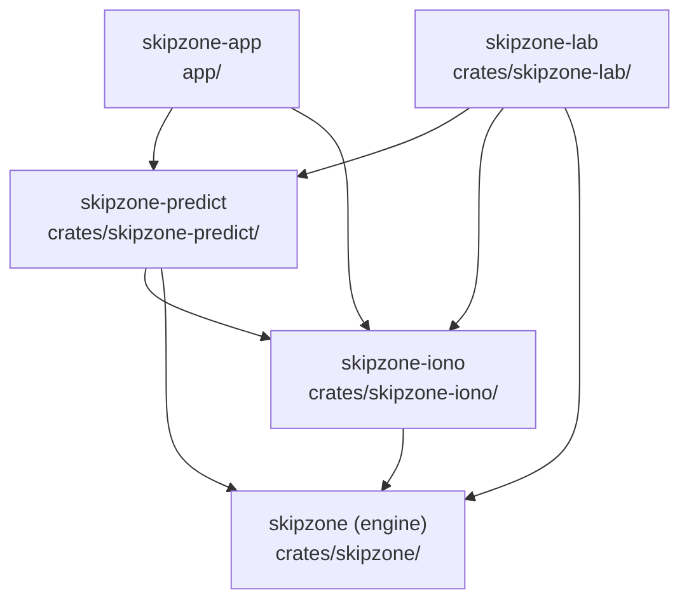

# Architecture

Skipzone is a Cargo workspace of five crates stacked in layers. The ray tracer
sits at the bottom, with the ionosphere and the prediction library above it.
The desktop app and the validation lab sit side by side at the top. For API
detail, build the rustdoc:

```bash
cargo doc --workspace --no-deps --open
```

## The crates



An arrow means "depends on". The root `Cargo.toml` is a virtual workspace with
`default-members = ["app"]`, so a bare `cargo run` builds and launches the
desktop app.

| Crate | Path | What it holds | MSRV |
|---|---|---|---|
| `skipzone` | `crates/skipzone/` | The engine: IGRF and dipole field models, the Appleton-Hartree dispersion relation, the Haselgrove ray equations, the adaptive integrator and the homing search | 1.85 |
| `skipzone-iono` | `crates/skipzone-iono/` | The ionosphere: Chapman layers, the CCIR foF2 and M(3000)F2 maps, the bundled foF2 grid, sporadic E, solar geometry, time and Maidenhead conversions | 1.88 |
| `skipzone-predict` | `crates/skipzone-predict/` | Headless link prediction: scenarios, the solve, link budget, noise, antennas, ground reflection, the frequency sweep, area coverage, the calibration anchors and the `hfpredict` CLI | 1.88 |
| `skipzone-lab` | `crates/skipzone-lab/` | Validation and calibration against WSPR spots, ionosonde data and solar indices, plus every harness binary | 1.95 (follows eframe) |
| `skipzone-app` | `app/` | The egui desktop front end | 1.95 (follows eframe) |

The engine knows nothing about the ionosphere. It traces through any type that
implements its `ElectronDensity` trait. `skipzone-iono` provides
`chapman::SolarChapmanLayer`, which is the model the predictions use.

## The dependency rule

A crate may depend only on crates in lower layers. The order is engine, then
iono, then predict, then lab and app on the same level. Lab and app never
depend on each other.

On top of that ordering, each crate has a list of things it may not pull in,
directly or through any dependency:

| Crate | May use | Banned |
|---|---|---|
| `skipzone` | `num-complex` and `thiserror` only, as normal dependencies | GUI crates, the network crate, `rayon` |
| `skipzone-iono` | the engine | GUI crates, the network crate, `rayon` |
| `skipzone-predict` | the engine, iono, `rayon`, `num-complex`, `shapefile` | GUI crates, the network crate |
| `skipzone-lab` | everything below it, `ureq` for HTTPS | GUI crates |
| `skipzone-app` | iono, predict, `eframe`, `egui` | the network crate |

"GUI crates" means `egui`, `eframe` and `winit`. "The network crate" means
`ureq`. Dev-dependencies are exempt, which is how the engine uses `criterion`
for its benchmarks.

[`scripts/check-boundaries.py`](https://github.com/GabrielVicini/Skipzone/blob/master/scripts/check-boundaries.py)
enforces all of this in CI. It reads `cargo metadata` and compiles nothing, so
you can run it locally in a second:

```bash
python3 scripts/check-boundaries.py
```

A new workspace crate fails the check until you add it to `LAYERS` in that
script.

## Why I split it this way

I keep the engine small so it stays portable and embeddable. It builds with
`std` and two crates, needs no system libraries, and forbids `unsafe`. Someone
who wants a different ionosphere can take the tracer without tearing one out.

I keep prediction headless so the lab harnesses run the same solver code as
the GUI. A calibration result then describes the program people run.

Network access lives in the lab and the GUI lives in the app. So the desktop
app makes no network calls, and lab downloads can't reach a prediction.

<!-- OWNER: the personal motivation for the five-crate split, if you want to add one (what prompted it, what you plan to do with the engine on its own). -->

## Threading

The engine and the ionosphere are single-threaded. All parallelism lives in
`skipzone-predict`, which runs whole independent solves on a private `rayon`
pool. Parallel and sequential runs give bit-identical results, and a test
checks that.

Predict starts no threads of its own beyond those pools. Its job runners in
`run` work on the calling thread, and the app calls them from one background
thread it owns (`app/src/jobs.rs`), so the window never waits on a solve.

Two environment variables control the pool at runtime, with no rebuild:

```text
SKIPZONE_COMPUTE=sequential     run everything on the calling thread
SKIPZONE_COMPUTE_THREADS=N      cap worker threads at N
```

If a result changes when you set `SKIPZONE_COMPUTE=sequential`, the bug is in
the parallel code.

## One prediction, end to end

The app turns its inputs into a scenario in `skipzone-predict`. That crate
builds the ionosphere and field models from `skipzone-iono` and the engine. It
then homes and traces rays through the engine and prices each path with the
link budget and noise model. The app's UI only draws the result. The function
names are in the rustdoc.

The physics behind each step is indexed in
[`docs/README.md`](https://github.com/GabrielVicini/Skipzone/blob/master/docs/README.md).
