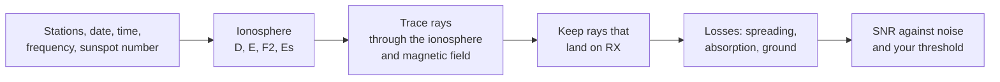

# How It Works

Skipzone builds a model of the ionosphere for your date, time and sunspot number.
It launches rays from the transmitter at many angles and follows each one as it bends.
It keeps the rays that land on the receiver, adds up their losses, and compares the result with the noise.
The maths is in the derivations linked at the end.

## Rays bend in the ionosphere

The ionosphere is a region of free electrons that starts about 60 km up.
Free electrons slow the phase of a radio wave, so a ray entering denser plasma bends away from it.
If the density keeps rising, the ray curves all the way round and comes back down.

How much density it takes depends on frequency.
Each electron density has a matching plasma frequency, roughly 9 √Ne Hz with Ne in electrons per cubic metre.
A ray sent straight up turns where the plasma frequency equals the radio frequency.
The highest frequency a layer returns straight up is its critical frequency, such as foF2 for the F2 layer.
Oblique rays need less bending, so a layer returns frequencies well above its critical frequency over a long path.
That limit is the MUF.

<!-- DIAGRAM: side view of three rays at the same frequency launched at low, medium and steep angles. The low and medium rays curve back to Earth at different ranges; the steep ray passes through the layer. Label the skip zone between the transmitter and the nearest landing. -->

## Finding the ray that reaches the receiver

Skipzone traces each ray in full 3D, so it can drift off the great-circle line.
To find the ray that lands on your receiver, it searches over launch angle until the landing point closes on the target.
It does this for one hop, two hops and so on, up to **Max hops** in **Settings** (default 4).

For a multi-hop path it aims one hop at a fraction of the distance, then traces every hop and bounce for real.
The **Terminal miss vs RX** figure in the trace panel shows how far the last hop landed from the receiver.

## The layers change with the sun and season

The model has four layers:

- **D**, around 70 km. Strong by day, with a weak remnant at night. Its main effect at HF is absorption.
- **E**, around 110 km. Strongest with the sun high, fading to almost nothing at night.
- **F2**, around 300 km. The main layer for long-distance HF, present day and night.
- **Sporadic E (Es)**, a thin sheet near 100 km that appears only some of the time.

D and E follow the sun's angle at every point along the path.
A path that crosses the day-night line is ionised only on its sunlit part, and the change across the line is smooth.

F2 comes from the CCIR numerical maps, a published set of coefficients fitted to ionosonde measurements.
They give foF2 by latitude, longitude, time of day and month, driven by the sunspot number.
So the **Sunspot number** in **Settings** drives most of the F2 prediction. Set it for the date you're planning.
The height of the F2 peak, **hmF2**, is a setting you choose (default 300 km).

<!-- DIAGRAM: electron density against height, with one curve for local noon and one for local midnight. Mark D, E and F2. The noon curve has a D bump and a strong E layer; the midnight curve has a much weaker D and almost no E. -->

### Sporadic E

Es is a dense, thin sheet of metal ions pushed together by winds in the upper atmosphere.
It can reflect frequencies well above what the regular E layer returns, which opens short skip on the higher bands.
It is most common on summer days at mid-latitudes.
Skipzone models its chance of being present from season, local time and latitude, and reports that chance with every Es path.
[Reading a Prediction](Reading-a-Prediction#sporadic-e-es) explains how it shows on screen.

## The magnetic field splits each ray

The Earth's magnetic field makes the free electrons spiral around the field lines.
As a result the ionosphere treats two polarisations of the wave differently.
Every ray splits into an ordinary (O) and an extraordinary (X) mode.
They bend by different amounts, reflect at different heights, and lose different amounts of energy.

Skipzone uses the IGRF-14 model of the real geomagnetic field.
The engine calculates the refractive index from the full [Appleton-Hartree relation](https://github.com/GabrielVicini/Skipzone/blob/master/docs/derivations/engine/appleton-hartree.md), with no quasi-longitudinal or quasi-transverse approximation.

<!-- OWNER: why you chose the full form, if you want to say -->

<!-- DIAGRAM: one launched ray splitting into an O ray and an X ray that turn at slightly different heights and land at slightly different points, with field lines drawn at an angle through the layer. -->

## Absorption

Electrons that oscillate in the wave collide with air molecules, and each collision turns some wave energy into heat.
Collisions are most frequent low down, so most absorption happens in the D layer.
That makes absorption a daytime effect, strongest when the sun is high.
Lower frequencies lose more, which is why 160 m and 80 m close by day.
The **Where the loss goes** chart in **Best FREQ** shows absorption against frequency for your path.

The way absorption follows the sun's angle is one of the model's known weak spots. See [Accuracy](Accuracy).

## The ground

On a multi-hop path the ray comes down, bounces off the ground and goes up again.
Each bounce loses some power, depending on what it hits and how steeply.
Sea water reflects best, and dry ground worst.

By default Skipzone checks every bounce point against the coastline map and picks sea, lake or land for that bounce.
The coastline data doesn't say what kind of soil is under a bounce, so land uses a fallback (default medium ground).
You can change both in **Settings > Surface (ground reflections)**.

<!-- DIAGRAM: a two-hop path with the first bounce on the ocean and the second on land, each bounce labelled with its surface type -->

## From ray to SNR

For each ray that lands, Skipzone adds up free-space spreading over the ray path, ionospheric absorption, and the ground loss at each bounce.

Antenna gain at each end is read at the ray's launch and arrival angles.
Man-made and galactic noise at the receiver come from ITU-R P.372-9. Atmospheric noise uses an approximation ([Reading a Prediction](Reading-a-Prediction#snr-and-the-threshold) has the caveat).
Your mode then sets the SNR threshold.
[Reading a Prediction](Reading-a-Prediction#snr-and-the-threshold) covers what the result means.

## The maths

Each piece of physics is derived before it is coded. The derivations are in the repository:

- [Ray equations (Haselgrove)](https://github.com/GabrielVicini/Skipzone/blob/master/docs/derivations/engine/haselgrove.md)
- [Refractive index and O/X modes (Appleton-Hartree)](https://github.com/GabrielVicini/Skipzone/blob/master/docs/derivations/engine/appleton-hartree.md)
- [Geomagnetic field (IGRF)](https://github.com/GabrielVicini/Skipzone/blob/master/docs/derivations/engine/magnetic-field.md)
- [Closed-form test cases](https://github.com/GabrielVicini/Skipzone/blob/master/docs/derivations/engine/analytic-solutions.md)
- [Layers near the day-night line (Chapman function)](https://github.com/GabrielVicini/Skipzone/blob/master/docs/derivations/iono/chapman-grazing.md)
- [Coordinates, units and sign conventions](https://github.com/GabrielVicini/Skipzone/blob/master/docs/derivations/conventions.md)

The [docs index](https://github.com/GabrielVicini/Skipzone/blob/master/docs/README.md) lists everything else.
[Architecture](Architecture) shows where each step lives in the code.
